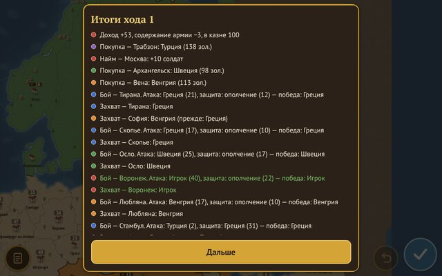

# WarPlanet

Пошаговая стратегия про захват провинций для Android — телефонов и планшетов. В партии до 8 игроков: двое живых на двух телефонах в одной Wi‑Fi сети и до 6 ИИ‑соперников. Сервер и интернет не нужны.


| Главное меню | Провинция и приказы | Итоги хода |
|---|---|---|
|  |  |  |

## Что есть в первой версии (MVP)

- Реальная карта Европы с упрощёнными контурами: 70 провинций суши, 26 морских зон, 12 стартовых столиц.
- Провинции с населением, доходом и счастьем; налог 0–200%, очки действия.
- Найм войск, укрепление, покупка нейтральных провинций, мародёрство.
- Бой со случайностью ±5%, одновременные ходы с конфликтами, флот появляется автоматически.
- ИИ‑соперники трёх уровней сложности, до 6 в партии.
- Условия победы: превосходство (порог 50–95%), доминирование, уничтожение, захват флага; лимит ходов.
- Игра вдвоём по Wi‑Fi (один телефон — хост), игра против ИИ, режим «на одном телефоне».
- Сохранение после каждого хода и «Продолжить».

Во второй этап (не входит): туман войны, типы юнитов и эпохи, дипломатия, режим «Защита», онлайн через Firebase.

## Как получить APK

### Вариант 1. GitHub Actions — без установки чего-либо

Каждый пуш запускает тесты и сборку (`.github/workflows/android.yml`). Готовый файл: вкладка **Actions** → последний запуск **Android APK** → артефакт **warplanet-apk** (zip с `app-release.apk`). Запуск можно сделать и вручную: **Run workflow**.

### Вариант 2. EAS (облачная сборка Expo)

```bash
npm install
npx eas-cli@latest login
npx eas-cli@latest build -p android --profile preview      # APK для установки на телефоны
npx eas-cli@latest build -p android --profile development  # dev build, работает вместе с `npx expo start`
```

Профили описаны в `eas.json`. Expo Go не подходит: нужны нативные модули для сети.

### Вариант 3. Локально

Нужны Node.js 20+, JDK 17+ и Android SDK (проще всего — через Android Studio).

```bash
npm install
npx expo prebuild -p android
cd android
./gradlew assembleRelease
# APK: android/app/build/outputs/apk/release/app-release.apk
```

Или сразу на подключённый телефон: `npx expo run:android`.

Release‑APK подписан отладочным ключом — его можно ставить на телефоны напрямую. Для Google Play нужен свой ключ: [инструкция Expo](https://docs.expo.dev/guides/local-app-production/).

## Как играть вдвоём по Wi‑Fi

1. Оба телефона в одной Wi‑Fi сети.
2. Первый: **Создать игру** — откроется лобби с настройками, IP и портом.
3. Второй: **Найти игру** — игра появится в списке (mDNS, `_conquest._tcp`). Если не появилась — введите IP и порт из лобби хоста.
4. Каждый нажимает на кольцо на карте, чтобы выбрать стартовую столицу. Хост нажимает **Начать**.

Ходы одновременные: каждый отдаёт приказы и жмёт **Готово**, хост считает ход за всех, включая ИИ. Если связь пропала, второй телефон переподключается сам и получает полное состояние; хост ждёт его до 2 минут, затем ставит паузу. Партия сохраняется на хосте после каждого хода.

## Управление

- Прокрутка карты — пальцем, зум — двумя пальцами.
- Тап по провинции — панель с данными и действиями: найм, укрепление, мародёрство, покупка соседней нейтральной.
- Перетащите плашку своей армии на соседнюю клетку — приказ на движение с выбором числа солдат. То же — кнопкой «Отправить армию» в панели.
- Налог — тап по значку налога в верхней панели.
- Кнопки внизу справа: «Отменить последний» и «Готово», рядом — готовность второго игрока.

## Структура кода

| Папка | Что внутри |
|---|---|
| `src/engine/` | Правила на чистом TypeScript, без React и сети: состояние, приказы, `resolveTurn(state, orders)`. Случайность — только из генератора с сидом партии |
| `src/engine/config.ts` | Все числа баланса из ТЗ — баланс подкручивается только здесь |
| `src/ai/` | ИИ‑соперники: `planOrders(state, playerId, difficulty)` |
| `src/net/` | Протокол (JSON по строкам: `hello`, `orders`, `state`, `ping`, `game_over`), хост, клиент, обнаружение |
| `src/game/` | Контроллер партии для всех режимов, сохранение |
| `src/ui/` | Экраны и отрисовка карты на Skia |
| `tools/maps/` | Скрипт сборки карт из Natural Earth в `assets/maps/*.json` |

Стек: Expo (React Native, TypeScript), `@shopify/react-native-skia`, `react-native-gesture-handler`, `react-native-reanimated`, `react-native-tcp-socket`, `react-native-zeroconf`, `@react-native-async-storage/async-storage`, `jest`.

## Разработка

```bash
npm install
npm test            # тесты движка, ИИ, карты и сети (по TCP на localhost)
npm run typecheck
npm run web         # браузерная версия для проверки интерфейса (без игры по сети)
npm start           # Metro для dev build на телефоне
```

### Карты

```bash
npm run maps        # node tools/maps/build.mjs europe
```

Скрипт сам скачивает Natural Earth, обрезает страны рамкой, сливает регионы в провинции примерно равной площади (внутри страны), делит море на зоны диаграммой Вороного, упрощает контуры через mapshaper, считает соседство по общим границам и добавляет проливы (Босфор, Дарданеллы, Эресунн, Керченский, Бонифачо). Настройки карты — `tools/maps/configs/europe.mjs`: страны, число провинций, затравки морских зон, проливы, стартовые столицы. Новая карта = новый файл настроек; движок от конкретной карты не зависит. Картинка для проверки — `tools/maps/out/<id>.svg`.

Чтобы провинций было ~60 при сохранении узнаваемых малых стран (Бельгия, Швейцария, страны Балкан — по одной провинции), вес страны при раздаче провинций учитывает площадь и немного население (`areaExponent`, `popExponent`). Внутри страны провинции примерно равны по площади. Крым выделен в отдельную нейтральную провинцию.

### Графика

Спрайты и иконки пока рисуются кодом в едином стиле. Чтобы заменить их картинками, положите PNG в `assets/sprites/` или `assets/ui/` с именами из `assets/LICENSES.md` и выполните `npm run assets`. Источник и лицензию каждого файла записывайте в `assets/LICENSES.md`.
